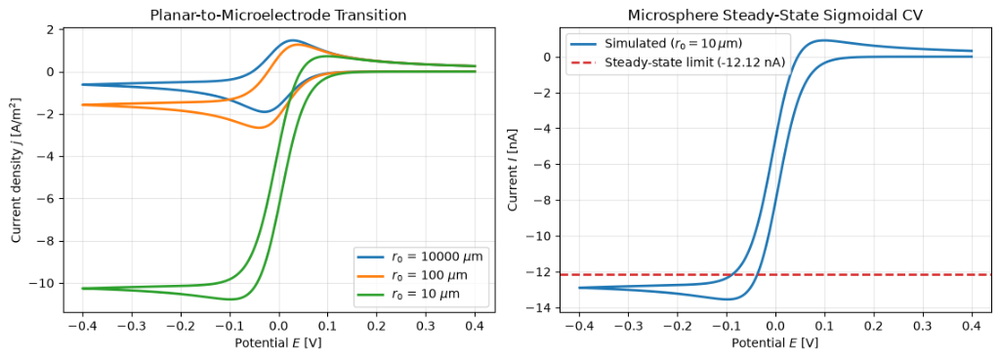
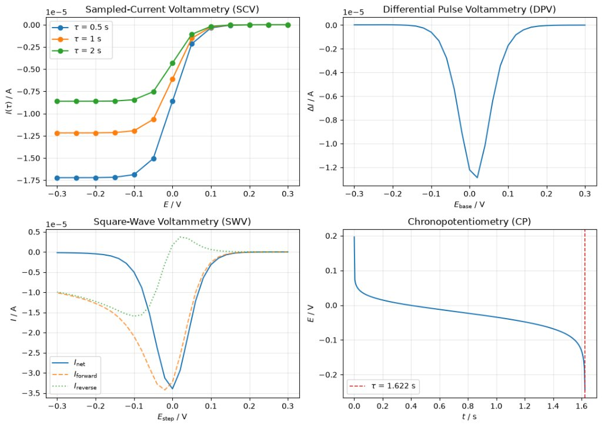
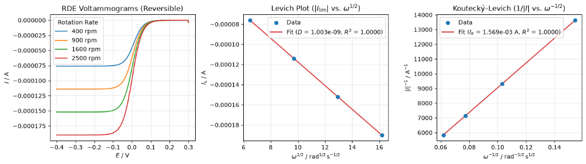
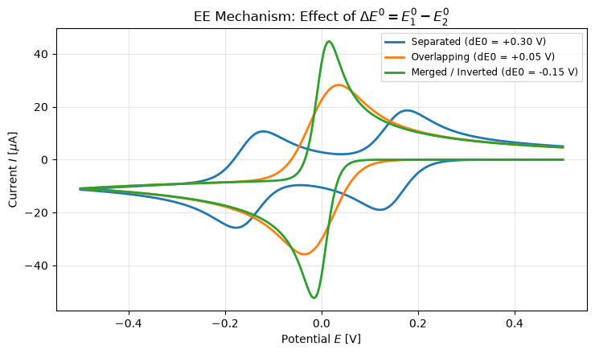

# Introducing the Redesigned softpotato.xyz and Soft Potato v3.4.2

The updated **Soft Potato** website is now live at **[softpotato.xyz](https://softpotato.xyz/)**! Along with the **v3.4.2** release, we have completely restructured the documentation around **three user personas** and brought together everything added across the v3.x milestones—from standard electrochemical techniques and custom waveforms to non-uniform grids, reaction mechanisms, and analytical fitting.

<!-- more -->

---

## Documentation Built Around Three Personas

Electrochemists come to simulation from very different backgrounds. Instead of a one-size-fits-all manual, the new [softpotato.xyz](https://softpotato.xyz/) lets you choose the path that matches your experience:

1. **Experimentalist** *(No Programming Experience)* — Start directly in your browser with zero-install [Google Colab](../../start/google-colab.md) notebooks, step-by-step Python setup, and a decision guide in [Start Here](../../start-here/index.md) to pick the right tool for your experiment.
2. **Python User** *(No Modelling Experience)* — Follow task-oriented workflows in the [User Guide](../../user-guide/index.md) to simulate standard techniques, plot results declaratively, and fit experimental datasets.
3. **Computational Modeller** — Dive into [Concepts](../../concepts/index.md) and the [Module Notebooks](../../tutorials/index.md) for full control over non-uniform meshes, coordinate geometries, coupled reaction mechanisms, and stiff PDE solvers.

---

## What’s New in Soft Potato v3

Across the v3.x release series, Soft Potato has grown into a modular, open-source electrochemical simulation and analysis toolkit in Python:

- **Techniques & Custom Waveforms:** High-level pipelines for chronoamperometry (CA), linear sweep and cyclic voltammetry (LSV, CV), sampled-current voltammetry (SCV), differential pulse voltammetry (DPV), square-wave voltammetry (SWV), chronopotentiometry (CP), and rotating disk electrode (RDE) voltammetry—plus support for custom potential/current waveforms, diagnostics, and declarative plotting.
- **Non-Uniform Grids:** Geometric and exponentially expanding spatial meshes to resolve steep concentration gradients near the electrode surface without wasting grid points in the bulk.
- **Geometries:** Planar, spherical, and cylindrical coordinate systems—capturing the transition from macroelectrodes to microelectrodes.
- **Mechanisms:** Coupled homogeneous chemical kinetics (EC, EC′, catalytic, EE) alongside heterogeneous charge-transfer kinetics (Nernst and Butler–Volmer).
- **Analytical Equations & Fitting:** Vectorized analytical models (`step`, `voltammetry`, `hydrodynamics`, `microelectrodes`, `secm`, `kinetics`), automated solver benchmarking, and parameter extraction from experimental data.
- **Different Solvers:** Switch between `scipy_ivp`, Crank–Nicolson, BTCS, and FTCS depending on your accuracy and stiffness requirements.

---

## Highlights from the Tutorials

A few examples from the updated [Tutorials](../../tutorials/index.md) illustrate what you can build out of the box:

### Planar-to-Microelectrode Transition & Spherical Steady State

Simulate how a reversible cyclic voltammogram evolves from diffusion-limited peaks at macroelectrodes ($r_0 = 10{,}000\ \mu\text{m}$) to a steady-state sigmoidal wave at a $10\ \mu\text{m}$ microsphere—matching the analytical steady-state limit.

### Pulse & Galvanostatic Techniques

Generate and analyze Sampled-Current Voltammetry (SCV), Differential Pulse Voltammetry (DPV), Square-Wave Voltammetry (SWV, including forward, reverse, and net currents), and Chronopotentiometry (CP) with transition time $\tau$.

### Hydrodynamics: RDE, Levich & Koutecký–Levich Analysis

Simulate rotating disk electrode voltammograms across multiple rotation rates (400–2500 rpm) and extract diffusion coefficients and kinetic currents directly via Levich and Koutecký–Levich fits.

### Multi-Electron Mechanisms (EE)

Explore how the formal potential separation $\Delta E^0 = E_1^0 - E_2^0$ shifts a two-step electron-transfer mechanism from separated waves to overlapping and merged/inverted peaks.

---

## Get Started

- **Browse the docs:** [softpotato.xyz](https://softpotato.xyz/)
- **Try in your browser:** [Google Colab Starter](https://drive.google.com/drive/folders/1aHJVZaPPRcIK2uy6OgobL8FOKzcMjjLx?usp=drive_link)
- **Install locally:** `pip install softpotato`
- **Source & issues:** [github.com/oliverrdz/softpotato](https://github.com/oliverrdz/softpotato)
