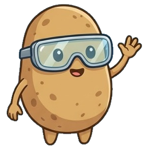
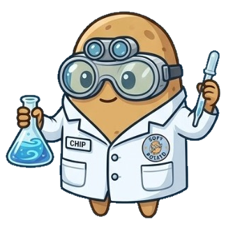
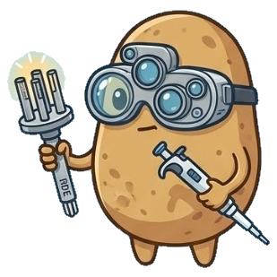
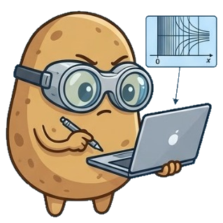

---
hide:
  - navigation
  - toc
---

<div class="sp-hero">
  <div class="sp-hero__content">
    <h1>Soft Potato</h1>
    <p class="sp-hero__tagline">
      Open-source electrochemical simulation and analysis toolkit in Python. Predict voltammetric, chronoamperometric, pulse, hydrodynamic, and SECM responses—or extract transport and kinetic parameters from experimental data—without fighting boilerplate PDE code.
    </p>
    <div class="sp-hero__metrics">
      <span class="sp-metric-pill"><strong>v3.4.1</strong> Techniques &amp; Diagnostics</span>
      <span class="sp-metric-pill"><strong>Analytical</strong> + Numerical PDEs</span>
      <span class="sp-metric-pill"><strong>Zero-Install</strong> Google Colab</span>
    </div>
    <div class="sp-hero__actions">
      <a class="md-button md-button--primary" href="start-here/">
        Start Here
      </a>
      <a class="md-button" href="https://drive.google.com/drive/folders/1aHJVZaPPRcIK2uy6OgobL8FOKzcMjjLx?usp=drive_link" target="_blank" rel="noopener">
        Try Live in Google Colab
      </a>
    </div>
    <div class="sp-hero__badges">
      <a href="https://drive.google.com/drive/folders/1aHJVZaPPRcIK2uy6OgobL8FOKzcMjjLx?usp=drive_link" target="_blank" rel="noopener">
        
      </a>
      <a href="https://pypi.org/project/softpotato/" target="_blank" rel="noopener">
        
      </a>
      <a href="https://github.com/oliverrdz/softpotato/blob/main/LICENSE" target="_blank" rel="noopener">
        
      </a>
    </div>
  </div>
  <div class="sp-hero__mascot">
    
  </div>
</div>

## Choose Your Path

Whether you are running your first simulation from the laboratory bench or building custom multi-species reaction–diffusion models, pick the path that matches your background:

<div class="grid cards" markdown>

-   { .sp-card-icon } **Experimentalist** *(No Programming Experience)*

    ---

    New to Python or numerical modelling? Start in your browser with Google Colab, install Soft Potato step by step, and use the decision guide to pick the right tool for your experiment.

    [:octicons-arrow-right-24: Go to Start Here](start-here/index.md)

-   { .sp-card-icon } **Python User** *(No Modelling Experience)*

    ---

    Comfortable with basic Python and ready to simulate CV, LSV, CA, pulse techniques, RDE, or fit experimental datasets? Follow task-oriented workflows using `softpotato.techniques` and `softpotato.analytical`.

    [:octicons-arrow-right-24: Go to User Guide](user-guide/index.md)

-   { .sp-card-icon } **Computational Modeller**

    ---

    Want full control over non-uniform meshes, spherical/cylindrical geometries, coupled reaction mechanisms, and stiff PDE solvers? Explore the underlying theory and interactive module notebooks.

    [:octicons-arrow-right-24: Explore Concepts](concepts/index.md)

    [:octicons-arrow-right-24: Module Notebooks](tutorials/index.md)

</div>

---

## Citation

If you use Soft Potato in your research or teaching, please cite the ChemRxiv preprint:

> Rodríguez, O. (2022). Soft Potato: an open source electrochemical simulator and toolkit. *ChemRxiv*. [doi:10.26434/chemrxiv-2022-4bs3w](https://doi.org/10.26434/chemrxiv-2022-4bs3w)

=== "BibTeX"

    ```bibtex
    @article{rodriguez2022softpotato,
      author    = {Rodr{\'i}guez, Oliver},
      title     = {Soft Potato: an open source electrochemical simulator and toolkit},
      journal   = {ChemRxiv},
      year      = {2022},
      doi       = {10.26434/chemrxiv-2022-4bs3w},
      url       = {https://chemrxiv.org/doi/full/10.26434/chemrxiv-2022-4bs3w}
    }
    ```

=== "APA"

    ```text
    Rodríguez, O. (2022). Soft Potato: an open source electrochemical simulator and toolkit. ChemRxiv. https://doi.org/10.26434/chemrxiv-2022-4bs3w
    ```

---

## Sponsor Soft Potato

!!! note "Support Open-Source Electrochemistry"
    Soft Potato is free and open source under the BSD 3-Clause License. If it helps your research, lab, or classroom, consider supporting its ongoing development:

    <iframe src="https://github.com/sponsors/oliverrdz/button" title="Sponsor oliverrdz" height="32" width="114" style="border: 0; border-radius: 6px; vertical-align: middle;"></iframe>
    &nbsp;&nbsp;
    or on [Buy Me a Coffee](https://www.buymeacoffee.com/oliverrdz).
