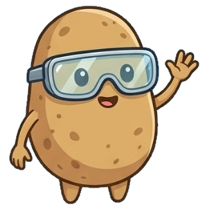
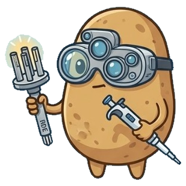
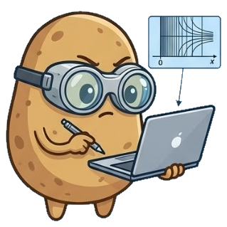
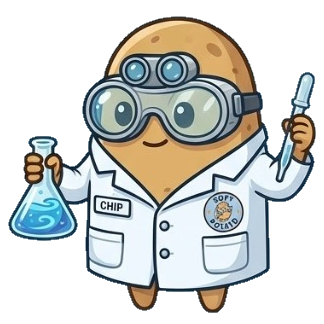

---
hide:
  - navigation
  - toc
---

<div class="sp-hero">
  <div class="sp-hero__content">
    <p class="sp-hero__eyebrow">Soft Potato &bull; Open-Source Electrochemistry Toolkit</p>
    <h1>Electrochemical Simulation Designed for the Laboratory Bench</h1>
    <p class="sp-hero__tagline">
      Predict voltammetric, chronoamperometric, hydrodynamic, and SECM responses—or extract transport and kinetic parameters directly from experimental data—using pure physical inputs (<i>E</i><sup>0</sup>, <i>k</i><sup>0</sup>, &alpha;, <i>D</i>, scan rates) without touching numerical meshes or differential equation code.
    </p>
    <div class="sp-hero__actions">
      <a class="md-button md-button--primary" href="https://colab.research.google.com/drive/1w9NfLV2j8ZZjjcVhAiPcogVnKb65wqE2" target="_blank" rel="noopener">
        Try Live in Google Colab
      </a>
      <a class="md-button" href="tutorials/">
        Explore Tutorials
      </a>
    </div>
    <div class="sp-hero__badges">
      <a href="https://colab.research.google.com/drive/1w9NfLV2j8ZZjjcVhAiPcogVnKb65wqE2" target="_blank" rel="noopener">
        
      </a>
      <a href="https://pypi.org/project/softpotato/" target="_blank" rel="noopener">
        
      </a>
      <a href="https://github.com/oliverrdz/softpotato/blob/main/LICENSE" target="_blank" rel="noopener">
        
      </a>
    </div>
  </div>
  <div class="sp-hero__mascot">
    
  </div>
</div>

<div class="grid cards sp-feature-grid" markdown>

-   { .sp-card-icon } **Instant Electrochemical Calculations**

    ---

    Generate exact theoretical baselines for **Cottrell**, **Levich**, **Koutecký–Levich**, **Randles–Ševčík**, **Butler–Volmer**, microelectrodes, and **SECM approach curves** ($I_T$ vs. $L$) in a single function call.

    [:octicons-arrow-right-24: Explore Analytical Equations](tutorials/modules/analytical.ipynb)

-   { .sp-card-icon } **Diffusion Layer Visualizer**

    ---

    Inspect how transient concentration profiles $c(x, t)$ and interfacial depletion zones evolve in time across planar, spherical, and cylindrical electrode geometries.

    [:octicons-arrow-right-24: Visualize Diffusion Profiles](tutorials/modules/geometries.ipynb)

-   { .sp-card-icon } **Quantitative Experimental Data Extraction**

    ---

    Automatically extract diffusion coefficients ($D$), heterogeneous rate constants ($k^0$), transfer coefficients ($\alpha$), and SECM parameters ($RG$, $d_0$) with 95% confidence intervals and $R^2$ diagnostics—no spreadsheets required.

    [:octicons-arrow-right-24: Data Fitting Toolkit](tutorials/modules/fitting.ipynb)

-   { .sp-card-icon } **Interactive Tutorials & Zero-Install Trial**

    ---

    Run Soft Potato v3 immediately in your browser with Google Colab or follow step-by-step guides covering chronoamperometry, cyclic voltammetry, and scientific Python for bench chemists.

    [:octicons-arrow-right-24: Try Soft Potato in your browser!](tutorials/python/google-colab-start.md)

</div>

---

## Try in Your Browser or Install Locally

=== "Zero-Install (Google Colab)"

    New to Python or want to test Soft Potato right at the bench? Open our interactive starter notebook in **Google Colab** to calculate chronoamperometric currents with `analytical.cottrell()` in seconds—nothing to install on your computer:

    [:octicons-play-24: Launch Soft Potato v3 Starter in Google Colab](https://colab.research.google.com/drive/1w9NfLV2j8ZZjjcVhAiPcogVnKb65wqE2){ .md-button .md-button--primary target="_blank" rel="noopener" }

=== "Local Installation (`pip`)"

    Install the latest stable release of Soft Potato from [PyPI](https://pypi.org/project/softpotato/) using `pip`:

    ```bash
    pip install softpotato
    ```

    Don't have Python installed yet? Follow our step-by-step guide: [Installing Python](tutorials/python/installing-python.md).

---

## Why Open-Source for Electrochemistry Research?

<div class="sp-section-banner" markdown>
<div markdown>
**Built for Experimental Transparency & Education.** Commercial simulation suites often lock electrochemical models behind hardware dongles, per-seat licenses, and opaque algorithms. Soft Potato empowers laboratories, students, and reviewers with a transparent, peer-reviewable toolkit. Follow our ongoing progress in the [Development Roadmap](roadmap.md) and [Changelog](changelog.md).
</div>

</div>

<div class="grid cards" markdown>

-   :material-check-decagram: **Transparent, Verifiable Equations**

    ---

    Every analytical model, regression bound, and transport equation is open and documented against standard electrochemical literature—eliminating black-box curve fits in your manuscripts.

-   :material-school: **Zero-Cost Classroom & Lab Access**

    ---

    Free for every student, postdoc, and teaching lab worldwide. Run simulations on any operating system or directly in a web browser via Google Colab without license servers.

-   :material-file-check: **Reproducible Supplementary Information**

    ---

    Share a concise Python script or Jupyter notebook alongside your raw potentiostat data so collaborators and peer reviewers can reproduce your kinetic extractions and figures in one click.

</div>

---

## Citation

If you use Soft Potato in your research or project, please cite the ChemRxiv preprint:

> Rodríguez, O. (2022). Soft Potato: an open source electrochemical simulator and toolkit. *ChemRxiv*. [doi:10.26434/chemrxiv-2022-4bs3w](https://doi.org/10.26434/chemrxiv-2022-4bs3w)

=== "BibTeX"

    ```bibtex
    @article{rodriguez2022softpotato,
      author    = {Rodr{\'i}guez, Oliver},
      title     = {Soft Potato: an open source electrochemical simulator and toolkit},
      journal   = {ChemRxiv},
      year      = {2022},
      doi       = {10.26434/chemrxiv-2022-4bs3w},
      url       = {https://chemrxiv.org/doi/full/10.26434/chemrxiv-2022-4bs3w}
    }
    ```

=== "APA"

    ```text
    Rodríguez, O. (2022). Soft Potato: an open source electrochemical simulator and toolkit. ChemRxiv. https://doi.org/10.26434/chemrxiv-2022-4bs3w
    ```

---

!!! note "Support Soft Potato"
    If you find Soft Potato useful in your research or teaching, consider supporting its ongoing open-source development:

    <iframe src="https://github.com/sponsors/oliverrdz/button" title="Sponsor oliverrdz" height="32" width="114" style="border: 0; border-radius: 6px; vertical-align: middle;"></iframe>
    &nbsp;&nbsp;
    or on [Buy Me a Coffee](https://www.buymeacoffee.com/oliverrdz).
