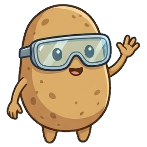
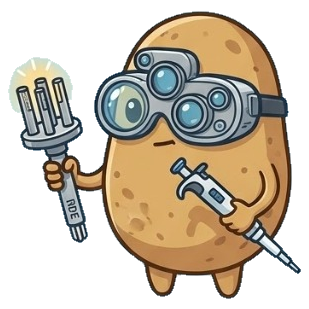
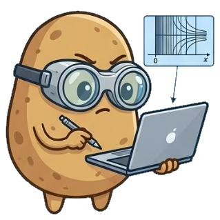
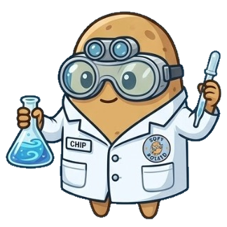

---
hide:
  - navigation
  - toc
---

<div class="sp-hero">
  <div class="sp-hero__content">
    <h1>Soft Potato</h1>
    <p class="sp-hero__tagline">
      An open-source electrochemical simulation and analysis toolkit in Python.
    </p>
    <div class="sp-hero__actions">
      <a class="md-button md-button--primary" href="api/">API Reference</a>
      <a class="md-button" href="tutorials/">Tutorials</a>
      <a class="md-button" href="blog/">Blog</a>
      <a class="md-button" href="roadmap/">Roadmap</a>
      <a class="md-button" href="changelog/">Changelog</a>
    </div>
  </div>
  <div class="sp-hero__mascot">
    
  </div>
</div>

<div class="grid cards sp-feature-grid" markdown>

-   { .sp-card-icon } **Analytical Electrochemistry**

    ---

    A library of commonly used electrochemical equations such as Cottrell, Nernst, Levich, Randles-Sevick, Butler-Volmer, SECM, etc.

    [:octicons-arrow-right-24: Analytical Module](api/analytical/index.md)

-   { .sp-card-icon } **Numerical PDE Solvers**

    ---

    1D multi-species reaction-diffusion solvers including stiff Method of Lines ODE integration (`scipy_ivp` Radau/BDF), Crank–Nicolson, and implicit/explicit finite-difference engines.

    [:octicons-arrow-right-24: Solver Module](api/solver.md)

-   { .sp-card-icon } **Parameter Fitting & Benchmarking**

    ---

    Extract diffusion coefficients ($D$), rate constants ($k^0$), transfer coefficients ($\alpha$), and SECM parameters ($R_g$, $d_{\text{offset}}$) with full confidence intervals, or validate numerical solvers against exact analytical solutions.

    [:octicons-arrow-right-24: Fitting & Benchmarks](api/analytical/fitting.md)

-   { .sp-card-icon } **Tutorials: Electrochemistry, Python & Linux**

    ---

    Interactive Jupyter notebooks for electrochemical simulations alongside practical tutorials on basic programming in Python.

    [:octicons-arrow-right-24: Browse Tutorials](tutorials/index.md)

</div>

---

## Installation

Install the latest stable release of Soft Potato from [PyPI](https://pypi.org/project/softpotato/) using `pip`:

```bash
pip install softpotato
```

Don't have Python? See [Installing Python](https://softpotato.xyz/tutorials/python/installing-python/).

---

## Quick Example

Simulate or evaluate analytical electrochemistry in just a few lines of Python:

```python
import numpy as np
import softpotato as sp

# 1. Analytical Cottrell current transient at a planar electrode
t = np.linspace(0.01, 10.0, 200)
current = sp.analytical.cottrell(
    t=t,
    n=1,
    D=1e-9,  # m^2 / s
    c_bulk=1.0,  # mol / m^3 (1 mM)
    A=1e-4,  # m^2 (1 cm^2)
)

# 2. Fit experimental chronoamperometric data to recover diffusivity D
fit = sp.analytical.fit_cottrell(t=t, current=current, n=1, A=1e-4, c_bulk=1.0)
print(f"Extracted D = {fit.D:.3e} m^2/s (R^2 = {fit.r_squared:.5f})")
```

!!! chip "Chip's Tip: Always Use SI Units!"
    Soft Potato functions use **SI base units** throughout: lengths in meters ($\text{m}$), areas in $\text{m}^2$, diffusion coefficients in $\text{m}^2\cdot\text{s}^{-1}$, and concentrations in $\text{mol}\cdot\text{m}^{-3}$ (conveniently, $1\text{ mM} = 1\text{ mol}\cdot\text{m}^{-3}$!).

---

## Citation

If you use Soft Potato in your research or project, please cite the ChemRxiv preprint:

> Rodríguez, O. (2022). Soft Potato: an open source electrochemical simulator and toolkit. *ChemRxiv*. [doi:10.26434/chemrxiv-2022-4bs3w](https://doi.org/10.26434/chemrxiv-2022-4bs3w)

=== "BibTeX"

    ```bibtex
    @article{rodriguez2022softpotato,
      author    = {Rodr{\'i}guez, Oliver},
      title     = {Soft Potato: an open source electrochemical simulator and toolkit},
      journal   = {ChemRxiv},
      year      = {2022},
      doi       = {10.26434/chemrxiv-2022-4bs3w},
      url       = {https://chemrxiv.org/doi/full/10.26434/chemrxiv-2022-4bs3w}
    }
    ```

=== "APA"

    ```text
    Rodríguez, O. (2022). Soft Potato: an open source electrochemical simulator and toolkit. ChemRxiv. https://doi.org/10.26434/chemrxiv-2022-4bs3w
    ```

---

!!! note "Support Soft Potato"
    If you find Soft Potato useful in your research or teaching, consider supporting its ongoing open-source development:

    <iframe src="https://github.com/sponsors/oliverrdz/button" title="Sponsor oliverrdz" height="32" width="114" style="border: 0; border-radius: 6px; vertical-align: middle;"></iframe>
    &nbsp;&nbsp;
    or on [Buy Me a Coffee](https://www.buymeacoffee.com/oliverrdz).
