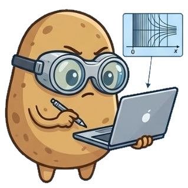

# Tutorials & Learning Guides

Welcome to the **Soft Potato Learning Hub**! Explore hands-on tutorials covering **electrochemistry**, **Soft Potato modules**, and scientific **Python programming**, for students, researchers, and computational scientists. This section is in active development and will be updated continuously.

---

## Python

Foundational scientific programming tutorials designed for researchers and engineers:

- [**Soft Potato on your browser**](python/google-colab-start.md) — Run Soft Potato in Google Colab. No Python installation needed!
- [**Installing Python on your computer**](python/installing-python.md) — Installing official Python across operating systems, setting up an isolated virtual environment, and running an analytical chronoamperometry test in IDLE to verify your setup.

## Soft Potato Modules

Hands-on guides exploring specific modules in the Soft Potato toolkit:

- [**Analytical Module**](modules/analytical.ipynb) — How to call closed-form electrochemical equations (`cottrell`, `levich`, `butler_volmer`, and `secm_approach_curve`) across analytical submodules and visualize results.
- [**Parameter Fitting**](modules/fitting.ipynb) — How to use `softpotato.analytical.fitting` (`fit_cottrell`, `fit_randles_sevcik`, `fit_secm_approach`, and `fit_curve`) to extract physical parameters from experimental data with statistical confidence.
- [**Numerical Solver**](modules/solver.ipynb) — Simulating multi-species reaction-diffusion problems with `DiffusionProblem()`, configuring Dirichlet and Neumann boundary conditions, and extracting concentration profiles and Faradaic currents with `SolverResult`.
- [**Geometry Module**](modules/geometries.ipynb) — Setting up spatial coordinate systems with `softpotato.geometry` (planar, cylindrical, and spherical), running spherical diffusion simulations, and visualizing 1D radial profiles, 2D Cartesian cross-sections, and Faradaic currents.
- [**Grid Module**](modules/grids.ipynb) — Constructing non-uniform spatial discretization meshes with `ExponentialMesh` in `softpotato.grid`, coupling with `DiffusionProblem()`, and comparing near-electrode concentration profiles and Faradaic current transients against `Uniform1DMesh` for the same number of nodes.

## Electrochemistry

Hands-on simulation workflows and benchmarks for classical electrochemical techniques:

- [**Chronoamperometry**](electrochemistry/ca.ipynb) — How to perform a chronoamperometry simulation and compare it with the `cottrell` function from the analytical module to demonstrate the full modeling workflow with Soft Potato.

---

