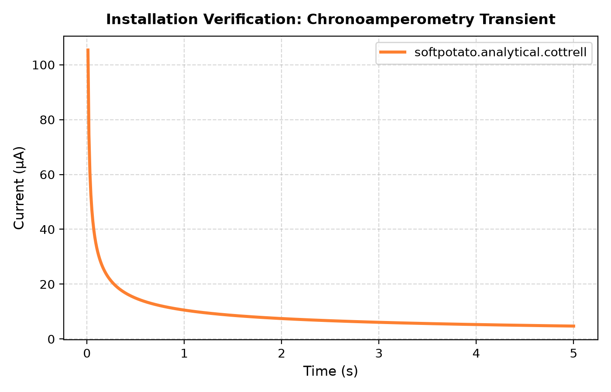

# Installing Python

Follow these steps to install Python, create an isolated environment, and verify your installation.

## 1. Install Python

=== "Windows"
    1. Download the installer from [python.org/downloads](https://www.python.org/downloads/).
    2. Run the downloaded installer.
    3. **Important:** On the first screen, check the box labeled **"Add python.exe to PATH"**.
    4. Click **Install Now**, then click **Close** when finished.

=== "macOS"
    1. Download the installer from [python.org/downloads](https://www.python.org/downloads/).
    2. Run the installer and complete the wizard.
    3. In Finder, open **Applications > Python 3.x** and double-click **`Install Certificates.command`**.

=== "Ubuntu / Debian"
    ```bash
    sudo apt update
    sudo apt install python3 python3-pip python3-venv idle
    ```

Verify the installation in your terminal:

=== "Windows"
    ```cmd
    python --version
    ```

=== "macOS / Linux"
    ```bash
    python3 --version
    ```

---

## 2. Create a Virtual Environment

Open your terminal, create a project folder, and navigate into it:

```bash
mkdir electrochem_project
cd electrochem_project
```

Create the virtual environment:

=== "Windows"
    ```cmd
    python -m venv .venv
    ```

=== "macOS / Linux"
    ```bash
    python3 -m venv .venv
    ```

Activate the environment:

=== "Windows (Command Prompt)"
    ```cmd
    .venv\Scripts\activate.bat
    ```

=== "Windows (PowerShell)"
    ```powershell
    .venv\Scripts\Activate.ps1
    ```

=== "macOS / Linux"
    ```bash
    source .venv/bin/activate
    ```

Once activated, your terminal prompt will show `(.venv)`.

---

## 3. Install Soft Potato

With your environment activated, install `softpotato`, `numpy` and `matplotlib`:

```bash
pip install softpotato numpy matplotlib
```

---

## 4. Test the Installation

Run a quick check in your terminal:

```bash
python -c "import softpotato, numpy, matplotlib; print('Installed successfully!')"
```

To verify calculations and plotting, run a test script:

1. Launch IDLE from your activated terminal:
    ```bash
    python -m idlelib
    ```
2. Click **File > New File** (<kbd>Ctrl</kbd>+<kbd>N</kbd> or <kbd>Cmd</kbd>+<kbd>N</kbd>).
3. Paste the following script:

    ```python
    import numpy as np
    import matplotlib.pyplot as plt
    from softpotato.analytical import cottrell

    # Experimental parameters
    n = 1
    c_bulk = 1.0  # mol/m^3
    D = 7.5e-10  # m^2/s
    electrode_radius = 1.5e-3  # m
    area = np.pi * (electrode_radius**2)

    # Time grid
    t = np.linspace(0.01, 5.0, 500)

    # Calculate current
    i_amperes = cottrell(t=t, n=n, D=D, c_bulk=c_bulk, area=area)
    i_microamps = i_amperes * 1e6

    # Plot
    plt.figure(figsize=(7, 4.5))
    plt.plot(
        t,
        i_microamps,
        color="#FD8031",
        linewidth=2.5,
        label="softpotato.analytical.cottrell",
    )
    plt.xlabel("Time (s)")
    plt.ylabel("Current (µA)")
    plt.title("Installation Verification: Chronoamperometry Transient")
    plt.grid(True, linestyle="--", alpha=0.5)
    plt.legend()
    plt.tight_layout()
    plt.show()
    ```

4. Save the file as `test.py` and press **F5** (or click **Run > Run Module**). *(Alternatively, run `python test.py` directly from your terminal).*

A plot window will appear confirming the installation is ready:



---

## 5. Starting Python Again

To resume work in a new terminal session, navigate to your project folder and activate the environment:

1. Open your terminal and navigate to your project folder:
    ```bash
    cd electrochem_project
    ```

2. Activate the virtual environment:

    === "Windows (Command Prompt)"
        ```cmd
        .venv\Scripts\activate.bat
        ```

    === "Windows (PowerShell)"
        ```powershell
        .venv\Scripts\Activate.ps1
        ```
        
    === "macOS / Linux"
        ```bash
        source .venv/bin/activate
        ```

3. Launch your script or editor:
    - **Run a script:** `python test.py`
    - **Launch IDLE:** `python -m idlelib`
    - **Interactive Python shell:** `python`

---

## 6. Adding New Libraries

To install additional scientific packages (such as `scipy` or `pandas`), ensure your virtual environment is active `(.venv)` and run `pip install`:

```bash
pip install scipy
```

Verify that the new package is available:

```bash
python -c "import scipy; print('SciPy installed successfully!')"
```

---

## Next Steps

- [Variables & Functions](variables-and-functions.md) — Learn Python syntax and data types.
- [Numerical Computing with NumPy](numpy-arrays.md) — Work with numerical arrays.
- [Data Visualization with Matplotlib](matplotlib-plotting.md) — Create scientific plots.
