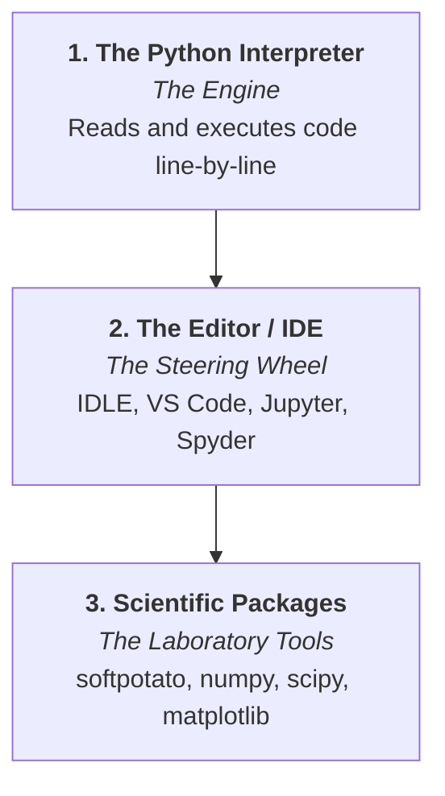

# Installing Python & First Simulation

Most electrochemists spend their days working with potentiostat software (such as BioLogic EC-Lab, Metrohm Nova, Gamry Framework, or CHI), spreadsheet tools like Excel, and plotting software like OriginLab. Transitioning to scientific Python might feel unfamiliar at first, but Python is one of the most approachable, human-readable programming languages in the world.

This tutorial guides you through the entire installation and setup process from scratch. By the end, you will have an isolated scientific Python environment and run an analytical chronoamperometry simulation with **Soft Potato** to verify that your system is configured correctly.

In this tutorial, you will:

1. Understand the three key pieces of the Python ecosystem (interpreter, editor, and libraries).
2. Install official Python on **Windows**, **macOS**, or **Ubuntu/Debian**.
3. Create an isolated project directory and **virtual environment** (`venv`).
4. Install **Soft Potato** and **Matplotlib**.
5. Compare development environments (IDEs) and use **IDLE** for a zero-setup quick start.
6. Run a verification script using `softpotato.analytical.cottrell` and verify the output plot.
7. Manage and export project dependencies with `requirements.txt`.

---

## 1. The Three Parts of Python

Before downloading anything, it helps to understand what "installing Python" actually means. A complete scientific Python setup consists of three distinct components:



1. **The Python Interpreter ("The Engine"):** The underlying program that translates text commands into instructions your computer hardware understands.
2. **The Editor or IDE ("The Steering Wheel"):** The software where you type, edit, and organize your code (such as IDLE, VS Code, or Jupyter).
3. **Scientific Packages ("The Laboratory Tools"):** Specialized extensions like **NumPy** (vectorized math), **Matplotlib** (plotting curves), and **Soft Potato** (electrochemical solvers and analytical equations).

---

## 2. Installing Python from the Official Website

To run Soft Potato, install the official Python distribution (version 3.10 or higher).

=== "Windows"
    1. Open your browser and go to [python.org/downloads](https://www.python.org/downloads/).
    2. Click the yellow **Download Python 3.x.x** button.
    3. Double-click the downloaded `.exe` installer.
    4. :octicons-alert-16: **CRITICAL STEP:** On the very first screen, check the box labeled **"Add python.exe to PATH"**. *(If this is not checked, your Windows terminal will not know where to find Python).*
    5. Click **Install Now**.
    6. When installation finishes, click **Disable path length limit** (if prompted), then click **Close**.

=== "macOS"
    1. Open your browser and go to [python.org/downloads](https://www.python.org/downloads/).
    2. Download the **macOS 64-bit universal2 installer** (`.pkg`).
    3. Run the downloaded installer and complete the setup wizard.
    4. In Finder, open **Applications > Python 3.x** and double-click **`Install Certificates.command`** to ensure Python can download scientific packages securely.

=== "Ubuntu / Debian"
    On Ubuntu and Debian systems, install the official Python packages and IDLE using `apt`:

    ```bash
    sudo apt update
    sudo apt install python3 python3-pip python3-venv idle3
    ```

---

### Verifying the Installation

Open the terminal of your operating system (PowerShell or Command Prompt on Windows, Terminal on macOS, or your terminal emulator on Linux) and verify that Python is accessible:

=== "Windows"
    ```cmd
    python --version
    ```

=== "macOS / Ubuntu / Debian"
    ```bash
    python3 --version
    ```

If the command prints `Python 3.10` or higher, your interpreter is installed and ready.

---

## 3. Creating a Project Folder & Virtual Environment

Establishing an isolated **virtual environment** is the single most important best practice in scientific computing.

### Why Use Virtual Environments?
When you install packages directly to your operating system's global Python:

* Different simulation projects may require incompatible versions of dependencies (e.g., `scipy 1.11` vs `scipy 1.14`).
* System package managers (such as `apt` or Homebrew) can conflict with `pip`.
* Modern Linux distributions (such as Ubuntu 24.04+ or Debian 12+) block direct `pip install` commands with `externally-managed-environment` errors to protect system stability.

A **virtual environment** is an isolated self-contained directory containing its own Python interpreter and package directory. Anything you install inside it never interferes with your system or other projects.

---

### Step A: Create and Open a Project Folder
In your terminal, create a directory for your work and navigate into it:

=== "Windows (Command Prompt / PowerShell)"
    ```cmd
    mkdir electrochem_project
    cd electrochem_project
    ```

=== "macOS / Ubuntu / Debian"
    ```bash
    mkdir electrochem_project
    cd electrochem_project
    ```

### Step B: Create the Virtual Environment
Inside your project folder, use Python's built-in `venv` module to create an environment named `.venv`:

=== "Windows"
    ```cmd
    python -m venv .venv
    ```

=== "macOS / Ubuntu / Debian"
    ```bash
    python3 -m venv .venv
    ```

*(The name `.venv` with a leading dot keeps the folder hidden and unobtrusive in file explorers).*

### Step C: Activate the Environment
You must activate the virtual environment before installing packages or running scripts:

=== "Windows (Command Prompt)"
    ```cmd
    .venv\Scripts\activate.bat
    ```

=== "Windows (PowerShell)"
    ```powershell
    .venv\Scripts\Activate.ps1
    ```
    *(If PowerShell displays a script execution error, run `Set-ExecutionPolicy -Scope Process -ExecutionPolicy Bypass` and try again).*

=== "macOS / Ubuntu / Debian"
    ```bash
    source .venv/bin/activate
    ```

Your terminal prompt will now show `(.venv)` at the start of the line, confirming the environment is active:

```text
(.venv) user@computer:~/electrochem_project$
```

### Deactivating the Environment
Whenever you want to exit your virtual environment, simply run:

```bash
deactivate
```

---

## 4. Installing Soft Potato and Matplotlib

With `(.venv)` active in your terminal, use `pip` (Python's package manager) to install **Soft Potato** and **Matplotlib**:

```bash
pip install --upgrade pip
pip install softpotato numpy matplotlib
```

To verify that both libraries are installed correctly, run this one-line check in your terminal:

=== "Windows"
    ```cmd
    python -c "import softpotato, matplotlib; print('Installed successfully!')"
    ```

=== "macOS / Ubuntu / Debian"
    ```bash
    python -c "import softpotato, matplotlib; print('Installed successfully!')"
    ```

!!! tip "Blazing Fast Alternative: `uv`"
    If you regularly create virtual environments, consider using [`uv`](https://github.com/astral-sh/uv), an extremely fast Python package manager written in Rust. With `uv` installed, you can create and populate environments in milliseconds:
    ```bash
    uv venv .venv
    uv pip install softpotato matplotlib
    ```

---

## 5. Choosing an Environment: Why We Use IDLE for Quick Start

There are several popular Integrated Development Environments (IDEs) used in scientific computing. Depending on your workflow, you may encounter:

| Environment | Best For | Learning Curve | Key Characteristics |
| :--- | :--- | :---: | :--- |
| **IDLE** | First-day learners, rapid sanity checks | ★☆☆☆☆ (Zero setup) | **Built into Python.** Opens in seconds with no configuration or account setup. |
| **JupyterLab** | Data exploration, CV plotting, lab reports | ★★☆☆☆ (Easy) | Runs in a browser; keeps experimental data in memory and renders plots inline. |
| **Spyder** | Transitioning from MATLAB or OriginLab | ★★☆☆☆ (Easy) | Multi-pane layout with a built-in **Variable Explorer** to view arrays like spreadsheets. |
| **VS Code** | Multi-file projects, simulation packages, Git | ★★★☆☆ (Moderate) | Powerful industry-standard editor with rich extensions and integrated terminals. |
| **Terminal (CLI)** | Automated batch scripts, cluster computing | ★★★☆☆ (Moderate) | Direct command-line execution without graphical interfaces. |

While tools like VS Code or JupyterLab are excellent for large-scale projects and interactive data exploration, **IDLE is the ideal tool for this tutorial**: it is already installed with Python, requires zero configuration, and lets you verify your setup immediately.

---

### Launching IDLE in Your Virtual Environment

!!! warning "Launch IDLE from the Terminal"
    If you launch IDLE from the Windows Start menu or macOS Applications folder, it opens using your **system global Python**, which does not have `softpotato` installed.
    
    To ensure IDLE has access to `softpotato` and `matplotlib`, **always launch it from your activated terminal**:

=== "Windows"
    ```cmd
    python -m idlelib
    ```

=== "macOS / Ubuntu / Debian"
    ```bash
    python -m idlelib
    ```

An IDLE window titled **Python 3.x.x Shell** will open on your screen.

---

## 6. Writing the Verification Script

We will write a short Python script to compute a chronoamperometry transient using `softpotato.analytical.cottrell` and plot the resulting curve with Matplotlib.

### Step A: Open a New File in IDLE
1. In IDLE, click **File > New File** (or press <kbd>Ctrl</kbd>+<kbd>N</kbd> on Windows/Linux, <kbd>Cmd</kbd>+<kbd>N</kbd> on macOS).
2. A blank script editor window will open.

### Step B: Paste the Script
Copy and paste the following code into the editor window:

```python
import numpy as np
import matplotlib.pyplot as plt
from softpotato.analytical import cottrell

# 1. Experimental parameters (SI units)
n = 1                     # Number of electrons
c_bulk = 1.0              # Bulk concentration [mol/m^3] (1.0 mM)
D = 7.5e-10               # Diffusion coefficient [m^2/s]
electrode_radius = 1.5e-3 # Disc radius [m] (3 mm diameter)
area = np.pi * (electrode_radius ** 2)

# 2. Time grid from 0.01 s to 5.0 s
t = np.linspace(0.01, 5.0, 500)

# 3. Calculate current using Soft Potato (returns Amperes)
i_amperes = cottrell(t=t, n=n, D=D, c_bulk=c_bulk, area=area)
i_microamps = i_amperes * 1e6  # Convert to microamperes (µA)

# 4. Generate the plot
plt.figure(figsize=(7, 4.5))
plt.plot(t, i_microamps, color="#FD8031", linewidth=2.5, label="softpotato.analytical.cottrell")
plt.xlabel("Time (s)")
plt.ylabel("Current (µA)")
plt.title("Installation Verification: Chronoamperometry Transient")
plt.grid(True, linestyle="--", alpha=0.5)
plt.legend()
plt.tight_layout()

# Display the plot window
plt.show()
```

### Step C: Save and Run
1. In the editor window, click **File > Save As...**.
2. Save the file inside your `electrochem_project` directory as:
   ```text
   test_chronoamperometry.py
   ```
3. Press <kbd>F5</kbd> on your keyboard (or click **Run > Run Module** in the menu).

---

## 7. Verifying the Installation

If your Python interpreter, virtual environment, Soft Potato, and Matplotlib installations were all successful, an interactive figure window will open displaying the plot below:


Seeing this plot confirms that:

* Python and the `.venv` virtual environment are working properly.
* Soft Potato is installed and its analytical engine calculated the transient.
* Matplotlib is installed and able to render graphical windows on your system.

---

## 8. Managing & Sharing Project Dependencies

To reproduce your exact simulation environment on another computer or lab workstation, generate a `requirements.txt` file from your activated terminal:

```bash
# Export all installed package versions
pip freeze > requirements.txt
```

On a new machine, recreate the identical environment with a single command:

```bash
python -m venv .venv
source .venv/bin/activate       # On Windows: .venv\Scripts\activate
pip install -r requirements.txt
```

!!! chip "Chip's Tip: Always Gitignore Your `.venv`"
    Never commit the `.venv` directory to Git! Virtual environments contain compiled, machine-specific binaries that should not be tracked in version control. Always add `.venv/` to your project's `.gitignore` file, and share your `requirements.txt` file instead.

---

## 9. Next Steps

Your scientific Python environment is now fully configured and verified!

!!! chip "Chip's Tip: Returning to Your Project Tomorrow"
    Whenever you close your computer and return to work tomorrow, remember the 2-step routine:
    
    1. Open your terminal and navigate to your folder: `cd electrochem_project`
    2. Activate your environment (`source .venv/bin/activate` or `.venv\Scripts\activate`) and launch IDLE: `python -m idlelib`
    
    You do **not** need to install Python, `softpotato`, or `matplotlib` again.

Continue exploring scientific Python and electrochemistry simulations:

- [**Python Fundamentals: Variables & Functions**](variables-and-functions.md) — Learn Python syntax, units, and writing reusable electrochemical equations.
- [**Numerical Computing with NumPy**](numpy-arrays.md) — Vectorized mathematical arrays and scientific computing without slow loops.
- [**Data Visualization with Matplotlib**](matplotlib-plotting.md) — Custom styling, multi-panel figures, and exporting publication-quality plots.
- [**Cottrell Chronoamperometry Simulation (Jupyter)**](../electrochemistry/cottrell.ipynb) — Compare analytical Cottrell solutions with full 1D finite-difference PDE numerical simulations.
